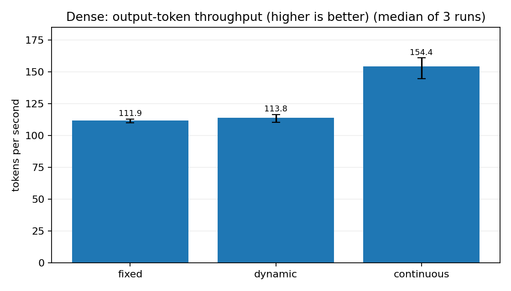
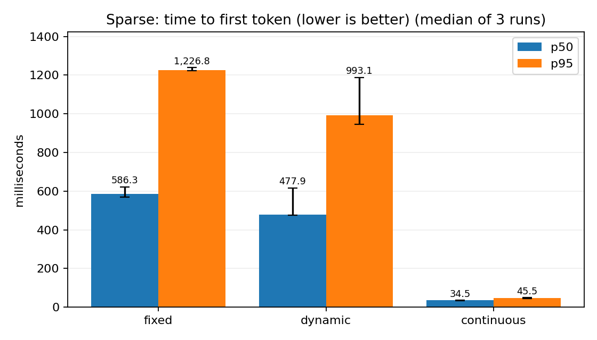
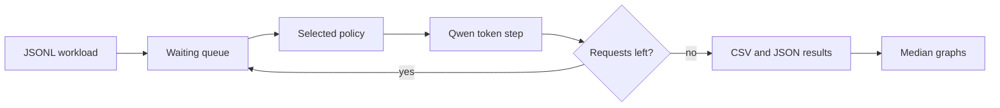

<div align="center">

# Dynamic Batch Formation Simulator

Real Qwen inference with fixed, dynamic, and continuous batching on an NVIDIA GPU.

[](https://github.com/AppajiDheeraj/Dynamic-Batch-Formation-Simulator/actions/workflows/docker.yml)
[](https://hub.docker.com/r/appajidheeraj/dynamic-batch-formation-simulator)
[](https://github.com/AppajiDheeraj/Dynamic-Batch-Formation-Simulator/pkgs/container/dynamic-batch-formation-simulator)
[](https://github.com/AppajiDheeraj/Dynamic-Batch-Formation-Simulator/releases/latest)
[](https://www.python.org/)

[Report](docs/EXPERIMENTAL_REPORT.pdf) · [LaTeX source](docs/EXPERIMENTAL_REPORT.tex) · [Measured results](docs/results/windows-rtx-5050-2026-10-10-wait50/) · [Architecture notes](docs/ARCHITECTURE_PLAN.md)

</div>

## What this project does

An LLM server receives requests at different times. The requests also ask for different numbers of output tokens. A batching policy decides when each request enters the GPU batch.

This project implements three policies and compares them with the same model, prompts, output limits, and inference code:

| Policy | When a batch starts | Can it refill an open slot? |
|---|---|---|
| Fixed | When four requests are ready | No |
| Dynamic | When four requests are ready or the oldest request has waited 50 ms | No |
| Continuous | At the next token step | Yes |

The benchmark runs `Qwen/Qwen2.5-0.5B-Instruct` in FP16. It does real token generation inside Docker. It does not simulate request timings.

## Result at a glance

The reported experiment used an NVIDIA GeForce RTX 5050 Laptop GPU. Each strategy ran three times on a dense workload and three times on a sparse workload. The table shows the median run.

| Workload and metric | Fixed | Dynamic | Continuous |
|---|---:|---:|---:|
| Dense throughput, tokens/s | 111.89 | 113.84 | **154.40** |
| Dense p50 latency, ms | 3934.17 | 4118.91 | **3082.77** |
| Sparse p50 latency, ms | 1506.56 | 1256.70 | **736.47** |
| Sparse p50 TTFT, ms | 586.26 | 477.85 | **34.53** |

Continuous batching kept 3.71 of four slots active on the dense workload. Fixed and dynamic batching averaged 2.50 active requests per token step because they did not refill slots after shorter requests finished.

<table>
  <tr>
    <td></td>
    <td></td>
  </tr>
  <tr>
    <td align="center">Dense throughput</td>
    <td align="center">Sparse time to first token</td>
  </tr>
</table>

The figures show medians. Each whisker spans the minimum and maximum of three runs. The [experimental report](docs/EXPERIMENTAL_REPORT.pdf) gives the full latency, TTFT, throughput, batch-size, and GPU-memory results.

## Container images

The project publishes the same Linux AMD64 image to two public registries:

| Registry | Image |
|---|---|
| [GitHub Packages](https://github.com/AppajiDheeraj/Dynamic-Batch-Formation-Simulator/pkgs/container/dynamic-batch-formation-simulator) | `ghcr.io/appajidheeraj/dynamic-batch-formation-simulator:latest` |
| [Docker Hub](https://hub.docker.com/r/appajidheeraj/dynamic-batch-formation-simulator) | `appajidheeraj/dynamic-batch-formation-simulator:latest` |

Pull either image:

```powershell
docker pull ghcr.io/appajidheeraj/dynamic-batch-formation-simulator:latest
docker pull appajidheeraj/dynamic-batch-formation-simulator:latest
```

The GitHub Packages image is public. Pulling it does not require a GitHub login. Run that image directly with:

```powershell
docker run --rm --gpus all -v "${PWD}/results:/app/results" -v batch-bench-hf-cache:/root/.cache/huggingface ghcr.io/appajidheeraj/dynamic-batch-formation-simulator:latest python -m batch_bench.experiment
```

## Run the benchmark

### Requirements

- An NVIDIA GPU with a current driver
- Docker with NVIDIA GPU access
- Docker Desktop with the WSL 2 engine when running on Windows
- Git

Check GPU access before running the benchmark:

```powershell
nvidia-smi
docker run --rm --gpus all nvidia/cuda:12.8.1-base-ubuntu22.04 nvidia-smi
```

Clone the repository:

```powershell
git clone https://github.com/AppajiDheeraj/Dynamic-Batch-Formation-Simulator.git
cd Dynamic-Batch-Formation-Simulator
```

### Use the prebuilt image

```powershell
docker compose pull
docker compose run --rm benchmark
```

Compose uses Docker Hub by default. The [Container images](#container-images) section also gives direct GHCR commands.

### Build from source

```powershell
docker compose build
docker compose run --rm benchmark
```

The first run downloads the model unless it is already in the Docker volume. The full command runs two workloads, three strategies, and three repetitions per strategy.

### Smoke test and unit tests

Run two requests through fixed batching:

```powershell
docker compose run --rm benchmark python -m batch_bench.run --strategy fixed --max-requests 2 --batch-size 2
```

Run the CPU-only tests:

```powershell
docker compose run --rm benchmark pytest -q
```

## How a run works



`docker compose run --rm benchmark` starts `batch_bench.experiment`. The experiment runs the dense workload and then the sparse workload. `run.py` starts one process for each strategy. The processes run in sequence, so two strategies never share the GPU.

Each process loads and warms the same model. The scheduler releases requests at their saved arrival times, admits requests under the selected policy, and generates one token for each active request. The strategy order rotates between repetitions to reduce order bias.

## Workloads and measurements

| Workload | Requests | Arrival gap | Output limits |
|---|---:|---:|---|
| Dense | 30 | 20 ms | 16, 32, and 48 tokens |
| Sparse | 30 | 400 ms | 16, 32, and 48 tokens |

The benchmark records:

- Output-token throughput
- Request latency at p50 and p95
- Time to first token at p50 and p95
- Active requests per token step
- Peak CUDA memory allocated by PyTorch

Each strategy directory contains:

```text
results/<workload>/run_<number>/<strategy>/
├── requests.csv   request timing, token counts, and generated text
├── steps.csv      token-step time and active batch size
└── summary.json   throughput, percentiles, makespan, and peak CUDA memory
```

Fresh runs write to the ignored `results/` directory. The evidence used in the report is committed under [`docs/results/windows-rtx-5050-2026-10-10-wait50/`](docs/results/windows-rtx-5050-2026-10-10-wait50/).

## Useful options

```text
--strategy fixed|dynamic|continuous|all
--workload workloads/prompts.jsonl
--model Qwen/Qwen2.5-0.5B-Instruct
--batch-size 4
--dynamic-wait-ms 50
--max-requests 2
--output-dir results
--repetitions 3
```

`--repetitions` works with `--strategy all`. The default is one run for quick checks.

## Repository layout

```text
.
├── src/batch_bench/       inference engine, schedulers, runner, and plotting
├── workloads/             dense, sparse, and default JSONL workloads
├── tests/                 scheduler, workload, and plotting tests
├── docs/
│   ├── figures/           figures embedded in the report
│   ├── results/           committed benchmark evidence
│   ├── EXPERIMENTAL_REPORT.tex
│   └── EXPERIMENTAL_REPORT.pdf
├── Dockerfile
├── compose.yaml
└── README.md
```

## Team 16

| Roll number | Member |
|---|---|
| 241CS110 | Appaji Nagaraja Dheeraj, team leader |
| 241CS145 | Rishinandan D R |
| 241CS214 | Ashlesh Prabhu |
| 241CS251 | Sachin Rohra |

Mentor: Balaji, [balajink252is009@nitk.edu.in](mailto:balajink252is009@nitk.edu.in)

## References

- [ORCA: A Distributed Serving System for Transformer-Based Generative Models](https://www.usenix.org/conference/osdi22/presentation/yu)
- [vLLM](https://github.com/vllm-project/vllm)
- [Qwen2.5-0.5B-Instruct](https://huggingface.co/Qwen/Qwen2.5-0.5B-Instruct)
- [Docker documentation](https://docs.docker.com/)
